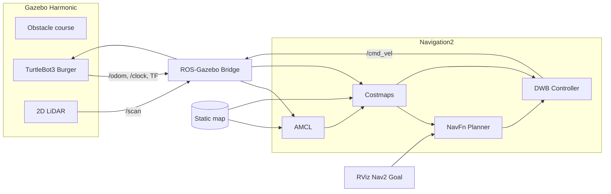

# TurtleBot3 LiDAR Autonomous Navigation

**ROS 2 Jazzy · Gazebo Harmonic · Navigation2**


---

## Table of Contents

1. [Overview](#1-overview)
2. [Key Features](#2-key-features)
3. [System Architecture](#3-system-architecture)
4. [Requirements](#4-requirements)
5. [Build and Launch](#5-build-and-launch)
6. [Environment and Map](#6-environment-and-map)
7. [Configuration](#7-configuration)
8. [Repository Structure](#8-repository-structure)
9. [Verification](#9-verification)
10. [Demo](#10-demo)

---

## 1. Overview

This project demonstrates goal-directed autonomous navigation of a TurtleBot3 Burger in a locally generated Gazebo obstacle course. The robot uses its simulated 2D LiDAR to detect obstacles and update the Nav2 costmaps, while Nav2 plans and executes a path to a goal selected in RViz.

The Gazebo world and the occupancy map are generated from a single source: the map raster is produced from the same box dimensions used to build the SDF world, so simulated obstacles and the navigation map stay aligned.

The project uses released ROS 2 packages for the robot model, Gazebo integration, and Nav2. It does not introduce a custom navigation algorithm and requires no custom ROS package beyond this workspace's `turtle_py_pkg`.

## 2. Key Features

- **Single-command bringup.** One XML launch file starts Gazebo, the Burger model, the ROS–Gazebo bridges, robot state publishing, Nav2 localization and navigation, and RViz.
- **Custom 12 m × 12 m indoor course** with 15 rectangular barriers and four boundary walls.
- **Fixed localization start.** AMCL initializes at the configured spawn pose `(-4.8, -4.8)` in the `map` frame.
- **Complete Nav2 stack.** Static map and AMCL for localization, NavFn for global planning, DWB for local control, and LiDAR observations for obstacle costmaps.
- **Interactive goals.** Select a destination with the RViz goal tool; the robot plans and navigates to it while avoiding detected obstacles.
- **Reproducible environment.** A generator script rebuilds the SDF world and its matching occupancy map from one obstacle definition.

## 3. System Architecture



| Component | Role |
|---|---|
| Gazebo Harmonic | Simulates the obstacle course, the Burger, physics, and sensors |
| ROS–Gazebo bridge | Publishes the simulated clock, LiDAR scan, odometry, and related robot data into ROS 2 |
| `/scan` (`sensor_msgs/msg/LaserScan`) | LiDAR observations used by the Nav2 obstacle layers and local avoidance |
| `/odom` (`nav_msgs/msg/Odometry`) and TF | Motion estimate and transforms used by localization and control |
| AMCL | Estimates the robot pose on the supplied map, initialized at the launch spawn pose |
| Nav2 costmaps | Combine the static map with live LiDAR obstacle observations |
| NavFn planner | Computes a global route through free map space |
| DWB controller | Follows the route and selects local velocity commands while accounting for obstacles |
| RViz | Displays the map, robot, scan, costmaps, and goal controls |

The simulated Burger also publishes an IMU topic, but the Nav2 configuration does not fuse IMU data.

## 4. Requirements

| Item | Version |
|---|---|
| Operating system | Ubuntu 24.04 LTS |
| ROS 2 | Jazzy Jalisco |
| Simulator | Gazebo Harmonic |
| Robot model | TurtleBot3 Burger |
| Build tool | `colcon` |

Install the required packages:

```bash
sudo apt update
sudo apt install \
  ros-jazzy-turtlebot3 ros-jazzy-turtlebot3-gazebo \
  ros-jazzy-navigation2 ros-jazzy-nav2-bringup \
  ros-jazzy-ros-gz-sim ros-jazzy-ros-gz-bridge \
  ros-jazzy-rviz2
```

## 5. Build and Launch

```bash
cd ~/ROS2_WS
source /opt/ros/jazzy/setup.bash
colcon build --symlink-install --packages-select turtle_py_pkg
source install/setup.bash
export TURTLEBOT3_MODEL=burger
ros2 launch turtle_py_pkg autonomous_navigation.launch.xml
```

Gazebo opens with the robot at its configured start pose. RViz opens with the map, LiDAR display, costmaps, and the Navigation2 panel.

> Wait until **Navigation** and **Localization** both show **active** before sending a goal.

### Send a navigation goal

1. In RViz, select **Nav2 Goal** (labeled **2D Goal Pose** in some toolbars).
2. Click a free location on the map.
3. Drag to set the desired final heading, then release.

Nav2 plans a path and drives the robot to the destination. Choose a goal with clearance around it; the costmaps show obstacle boundaries.

### Shut down

Press **Ctrl+C** in the launch terminal. Do not run a second instance while one is already running.

## 6. Environment and Map

| File | Purpose |
|---|---|
| `src/turtle_py_pkg/worlds/complex_obstacle_world.sdf` | Gazebo world: floor, lighting, collision geometry, and 19 static box models (15 barriers + 4 perimeter walls) |
| `src/turtle_py_pkg/maps/complex_obstacle_world.yaml` | Nav2 map metadata: origin `[-6, -6, 0]`, resolution 0.05 m/px |
| `src/turtle_py_pkg/maps/complex_obstacle_world.pgm` | 240 × 240 occupancy raster aligned to the world geometry |
| `src/turtle_py_pkg/scripts/generate_environment.py` | Single source for box dimensions; regenerates the world and matching map |

### Customize the obstacle course

Edit the `OBSTACLES` list in `generate_environment.py`. Each entry defines a model name, center `(x, y)`, footprint dimensions, and height in metres. Keep the spawn point clear and the corridors wide enough for the robot. Then regenerate and rebuild:

```bash
python3 src/turtle_py_pkg/scripts/generate_environment.py
colcon build --symlink-install --packages-select turtle_py_pkg
```

## 7. Configuration

| Setting | Location |
|---|---|
| Nav2 parameters (AMCL, costmaps, NavFn, DWB) | `src/turtle_py_pkg/config/burger_nav2.yaml` |
| RViz configuration | `src/turtle_py_pkg/config/` |
| Spawn pose (`x_pose`, `y_pose`) | `src/turtle_py_pkg/launch/turtlebot3_nav_demo.launch.py` |
| AMCL initial pose | `initial_pose` in `burger_nav2.yaml` |

> If you change the spawn pose, update both the launch arguments `x_pose` / `y_pose` and the AMCL `initial_pose` to the same coordinates.

## 8. Repository Structure

```text
.
├── README.md
└── src/
    └── turtle_py_pkg/
        ├── config/     # Nav2 parameters and RViz configuration
        ├── launch/     # XML entry point and underlying ROS launch description
        ├── maps/       # Generated occupancy map and metadata
        ├── scripts/    # World and map generator
        └── worlds/     # Generated Gazebo SDF world
```

## 9. Verification

- The package builds with `colcon`.
- The XML launch file resolves through the ROS 2 launch system.
- The generated SDF, map metadata, and raster dimensions are checked for consistency.

Runtime checks:

```bash
ros2 topic hz /scan              # LiDAR publishing
ros2 topic echo /odom --once     # Odometry available
ros2 lifecycle get /amcl         # Expect: active
```

## 10. Demo

Demonstration recording of the full navigation run (Gazebo, RViz, and the Nav2 goal sequence):

**[View the demo on Google Drive]([https://drive.google.com/drive/folders/1kq9wbNynDnJ50TlxhLHUYBK5iZ_w5_FH?usp=sharing](https://drive.google.com/file/d/1Y_X_MaSXXOAj6DE9ipW5mSObmY1as3av/view?usp=sharing))**
